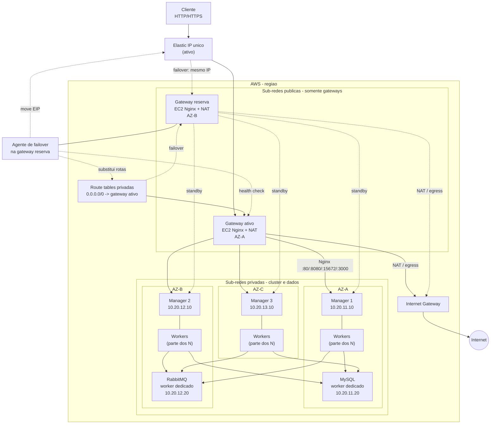
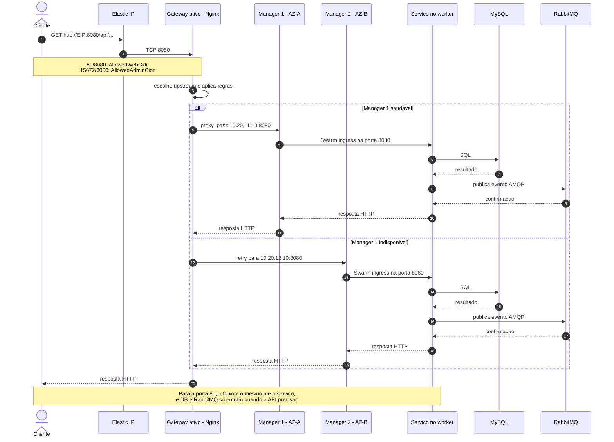
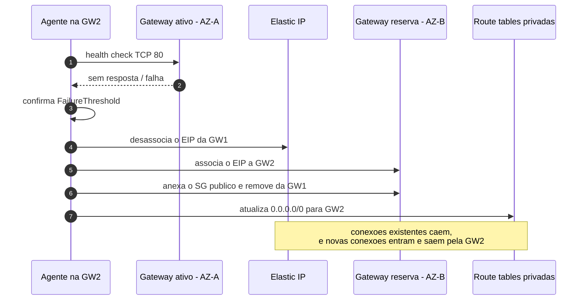

# Arquitetura alvo - Studio Essencia

**Status:** arquitetura implantada e validada no AWS Academy com `N=2` (9
instancias running), incluindo Swarm, aplicacao, dados MySQL/RabbitMQ e
failover/failback. Em 2026-10-29 o ambiente AWS foi destruido para interromper o
consumo; nao ha stacks, instancias, volumes, snapshots nem EIP ativos. Os
templates desta pasta e o guia `STEP-BY-STEP-CONSOLE.md` recriam o laboratorio
pelo console; `scripts/destroy-all.ps1` remove os recursos. A rotina de
restauracao logica e teste periodico de backup continua pendente.

Este documento descreve a arquitetura alvo implementada nesta pasta. Ela
substituiu o desenho anterior com Network Load Balancer (NLB), dois Elastic IPs
e instancias em sub-redes publicas. O fluxo ativo e o descrito aqui.

| Item | Estado |
|---|---|
| Arquitetura alvo | implementada em codigo nos tres templates |
| Gateways Nginx/NAT e failover | implementados e testados; ambiente removido no teardown |
| Cluster com tres managers | implantado com `N=2` workers; atualmente removido |
| MySQL e RabbitMQ dedicados | implantados com volumes EBS; volumes e snapshots removidos no teardown |
| Aplicacao | publicada e validada; atualmente removida junto com o cluster |
| Snapshots EBS | nao existem no momento; restauracao logica/teste periodico pendentes |
| Lambda/CloudWatch de failover | nao usado; `N=2` cabe no limite; `N=3` exigiria abrir mao do gateway reserva |

## 1. Objetivo e premissas

O objetivo e manter o cluster Docker Swarm em uma rede privada, expondo apenas
um endereco publico fixo para os clientes. A arquitetura precisa sobreviver a
falha de um manager e, no control plane, a perda de uma Availability Zone (AZ),
sem tratar MySQL ou RabbitMQ como servicos altamente disponiveis quando eles
nao sao.

Premissas:

- Regiao unica; o laboratorio atual usa `us-west-2`, e os templates sao
  agnosticos de regiao.
- VPC `10.20.0.0/16`, com tres AZs disponiveis.
- Um Elastic IP publico, usado tanto para entrada HTTP/HTTPS quanto para a
  saida NAT das instancias privadas.
- Tres managers, um por AZ, e `N` workers de aplicacao distribuidos entre as AZs.
- Duas instancias gateway em sub-redes publicas, uma ativa e outra em espera.
- Uma instancia dedicada para MySQL e uma para RabbitMQ, ambas privadas.
- Acesso administrativo por SSM Session Manager, VPN ou SSH atraves de um
  gateway; nenhuma instancia do cluster tera IP publico.
- A implementacao usa um agente na gateway reserva, com o instance profile da
  instancia, em vez de Lambda/CloudWatch. Isso evita a criacao de role IAM no
  AWS Academy. O desenho conceitual com Lambda continua valido como evolucao.

Fora do escopo inicial:

- Multi-regiao e recuperacao de desastre entre regioes.
- MySQL e RabbitMQ altamente disponiveis.
- Active-active de gateways com o mesmo Elastic IP.
- WAF, protecao DDoS avancada e gestao de dominio como requisito obrigatorio.
- Substituir Docker Swarm por Kubernetes.

## 2. Visao geral

O cliente acessa um unico Elastic IP. Esse IP pertence ao gateway ativo, que
executa Nginx e faz NAT para as sub-redes privadas. O Nginx encaminha as portas
da aplicacao para o ingress do Swarm nos tres managers. O ingress distribui a
requisicao para uma tarefa do servico, que pode estar em qualquer worker.



A fonte Mermaid deste diagrama esta em
[`diagrams/architecture.mmd`](diagrams/architecture.mmd).

Legenda: linhas continuas representam o caminho ativo; linhas tracejadas
representam o gateway em espera ou a acao de failover. O Elastic IP aparece
apenas no gateway ativo, mas pode ser movido para o reserva.

## 3. Decisoes e justificativas

### 3.1 Tres Availability Zones

A arquitetura usa tres AZs para colocar um manager em cada uma. Isso e o que
permite perder uma AZ inteira e ainda manter dois managers vivos.

O quorum do Raft do Docker Swarm e calculado por maioria:

| Managers | Quorum | Tolera falha de |
|---:|---:|---|
| 1 | 1 | nenhuma |
| 2 | 2 | nenhuma |
| 3 | 2 | 1 manager |
| 4 | 3 | 1 manager |
| 5 | 3 | 2 managers |

Com dois managers, uma falha deixa apenas um no e o cluster perde quorum. Por
isso, a escolha de tres managers e o menor numero que tolera uma falha. Cinco
managers tolerariam duas falhas, mas aumentam custo e complexidade sem necessidade
para este projeto.

Se os tres managers estiverem em apenas duas AZs, a falha da AZ que contem dois
managers deixa somente um manager, e o cluster tambem perde quorum. Distribuir
um manager por AZ e o que combina a tolerancia do Raft com a tolerancia de AZ.

Os workers devem ser distribuidos entre as tres AZs. Para que todas as AZs
tenham pelo menos um worker, o recomendado e `N >= 3`; com `N = 2`, a aplicacao
continua funcionando, mas nao ha garantia de presenca em todas as AZs.

**Decisao:** managers dedicados ao control plane, sem tarefas de aplicacao. Os
servicos da aplicacao rodam nos workers. Isso reduz a chance de um pico de
aplicacao prejudicar o quorum e simplifica o diagnostico. Os managers continuam
ativos e com o ingress do Swarm; nao devem ser drenados, porque o Nginx os usa
como entrada. No Compose, os servicos de aplicacao devem ter constraints
`node.role == worker` e um label de aplicacao, para nao serem agendados nos
managers nem nos nos de dados. Se o custo obrigar a usar managers tambem como
workers, essa premissa deve ser revista.

### 3.2 Rede privada e sub-redes

Somente as duas instancias gateway ficam em sub-redes publicas. Managers,
workers, MySQL e RabbitMQ ficam em sub-redes privadas, sem IP publico e sem rota
direta para a internet. A saida para atualizacoes, Docker Hub, SSM e APIs da AWS
acontece pelo NAT executado no gateway ativo.

Justificativas:

- A superficie publica fica reduzida a duas instancias e ao Elastic IP.
- O cluster nao depende de IP publico em cada no.
- Security groups podem usar referencia de security group, em vez de faixas de
  IP da internet.
- O acesso administrativo pode ser centralizado em SSM ou em um unico ponto de
  entrada SSH.

O custo dessa escolha e operacional: NAT em EC2 precisa de manutencao, limite de
banda e failover. Um NAT Gateway gerenciado eliminaria essa manutencao, mas
criaria outro Elastic IP e outro custo por hora e por GB, alem de nao resolver
sozinho o requisito de um unico IP publico.

### 3.3 Dois gateways e um unico Elastic IP

O requisito de um unico IP publico leva a um par ativo/passivo:

- O gateway ativo tem o Elastic IP e atende o trafego de entrada.
- O gateway reserva fica pronto, na outra AZ, sem Elastic IP.
- Se o ativo falhar, o IP e movido para o reserva, as rotas privadas passam a
  apontar para o novo gateway e o servico volta.

Nao existe active-active real com um unico Elastic IP. Um IP pode estar
associado a uma ENI por vez. Para active-active seriam necessarios, por exemplo,
dois IPs em um NLB ou um acelerador global, o que nao atende ao requisito de um
unico endereco.

O gateway tem duas funcoes no mesmo EC2:

1. **Nginx:** termina HTTP/HTTPS e faz proxy para o ingress do Swarm.
2. **NAT:** encaminha o trafego de saida das sub-redes privadas.

As duas funcoes compartilham o mesmo IP publico. Isso simplifica o requisito de
IP unico, mas significa que a falha do gateway afeta entrada e saida ao mesmo
tempo. O failover precisa mover o Elastic IP e atualizar as rotas privadas.
Como consequencia, servicos externos que usam allowlist veem o mesmo IP de
saida e de entrada; nao ha um IP separado para egress. As conexoes NAT usam
portas efemeras e nao conflitam com as portas de entrada do Nginx.

O gateway reserva tambem precisa estar em uma sub-rede publica, mesmo sem o EIP
no dia a dia. Isso permite associar o Elastic IP a ele durante o failover. O EIP
e o unico endpoint web divulgado.

A implementacao usa uma concessao pratica para o bootstrap: as duas instancias
gateway recebem IPv4 publico automatico e instalam Nginx/NAT via internet. O
security group de aplicacao e anexado somente ao gateway ativo; a reserva tem
apenas os security groups de management e NAT, portanto o IP automatico da
reserva nao abre 80, 8080, 15672 nem 3000. O agente de failover anexa o SG de
aplicacao a reserva no momento da promocao. Se o requisito for literalmente
nenhum IPv4 automatico, use uma AMI pre-configurada e remova o IP automatico da
reserva depois do bootstrap.

O NAT ativo precisa estar funcional antes de managers, workers e nos de dados
baixarem Docker e imagens. O user data do cluster tem retry de apt e de rede
para tolerar a janela em que o gateway ainda esta subindo.

### 3.4 Nginx como ponto de entrada

O Nginx foi escolhido porque:

- Permite um unico Elastic IP sem depender de DNS ou de um balanceador gerenciado.
- Faz proxy HTTP/HTTPS, o que e suficiente para frontend, API, RabbitMQ
  Management e WAHA.
- Permite encaminhar portas diferentes para upstreams diferentes.
- Permite aplicar timeouts, limites de corpo, WebSocket e cabecalhos de seguranca.
- Pode ser configurado por user data/SSM em ambas as instancias, mantendo a
  configuracao igual no ativo e no reserva.

As portas publicadas atualmente sao:

| Porta | Destino no Swarm | Observacao |
|---:|---|---|
| 80 | frontend | liberado para `AllowedWebCidr` |
| 8080 | API/backend | liberado para `AllowedWebCidr` |
| 15672 | RabbitMQ Management | liberado apenas para `AllowedAdminCidr` |
| 3000 | WAHA | liberado apenas para `AllowedAdminCidr` |

O Nginx deve manter um upstream com os tres IPs privados dos managers. O
balanceamento pode ser round-robin; o mais importante e ter retry para outro
manager quando o primeiro falhar. Os managers precisam de IPs fixos; os workers
de aplicacao ficam em Auto Scaling Group e podem mudar de IP, por isso o
upstream do Nginx nao aponta para eles:

```nginx
upstream swarm_managers {
    server 10.20.11.10:8080 max_fails=3 fail_timeout=10s;
    server 10.20.12.10:8080 max_fails=3 fail_timeout=10s;
    server 10.20.13.10:8080 max_fails=3 fail_timeout=10s;
}
```

Esse exemplo e para a porta 8080. As portas 80, 15672 e 3000 precisam de blocos
equivalentes, apontando para os mesmos managers, porque o ingress routing mesh do
Swarm escuta as portas publicadas em todos os nos. O Nginx nao deve apontar
diretamente para um worker especifico: se esse worker for removido, o proxy fica
preso a um alvo que pode nao existir mais. Tambem nao inclua os nos de dados no
upstream; eles sao dedicados a dados e nao devem ser usados como ponto de
entrada do Nginx.

Os servicos precisam usar o modo de publicacao `ingress` do Swarm (o padrao).
Com `mode: host`, a porta fica publicada apenas no no que executa a tarefa, e o
Nginx apontando para os managers nao encontraria o servico em todos os casos.

Na configuracao do proxy, use
`proxy_next_upstream error timeout http_502 http_503 http_504;` para tentar o
proximo manager quando o primeiro falhar. Para requisicoes que nao sao
idempotentes, avalie o risco de repeticao antes de habilitar retry automatico.

Limitacoes do Nginx Open Source:

- Health check ativo de upstream nao faz parte do nucleo do Nginx Open Source.
  O failover entre managers e passivo (`max_fails` e `fail_timeout`).
- Um monitor externo, CloudWatch ou um sidecar pode complementar a deteccao.
- O Nginx precisa ser atualizado e monitorado como qualquer outro componente.

Para WebSocket do WAHA, a configuracao precisa de `proxy_http_version 1.1`,
`Upgrade` e `Connection`. Para uploads grandes, os timeouts e
`client_max_body_size` devem ser ajustados.

### 3.5 Por que nao usar NLB ou ALB

| Opcao | Vantagens | Limitacoes para este requisito |
|---|---|---|
| NLB | gerenciado, IPs estaticos por AZ, alta disponibilidade | com duas AZs, normalmente entrega dois Elastic IPs; nao atende ao requisito de um unico IP |
| NLB em uma AZ | um IP estatico | perde a tolerancia a falha de AZ no ponto de entrada |
| ALB | gerenciado, roteamento L7, integracao com certificados | nao fornece IP publico estatico; depende de DNS |
| API Gateway | gerenciado, bom para APIs HTTP | nao cobre bem portas TCP arbitrarias como RabbitMQ/WAHA; custo por requisicao |
| Global Accelerator | IPs anycast e alta disponibilidade | fornece mais de um IP e tem custo/complexidade maiores |
| Nginx em EC2 | um IP, L7, controle total | manutencao, failover e capacidade sao responsabilidade da equipe |

O NLB com dois EIPs seria a alternativa mais simples se o requisito fosse "dois
IPs fixos" em vez de "um IP fixo". O ALB seria mais conveniente se um nome DNS
pudesse ser o ponto de entrada e se um NAT Gateway separado cuidasse da saida.
Nenhuma das duas opcoes atende simultaneamente a um unico IP, L7 e NAT no mesmo
ponto.

Se o requisito de um unico IP puder ser relaxado, o NLB com dois EIPs e a opcao
mais robusta e de menor esforco operacional. O Nginx em EC2 se justifica aqui
pelo IP unico, pelo controle L7 e por reunir NAT no mesmo ponto de entrada; o
preco e o failover proprio.

### 3.6 MySQL e RabbitMQ dedicados

MySQL e RabbitMQ ficam em duas instancias EC2 dedicadas, uma para cada servico.
Elas entram no Swarm como workers com labels, mas nao recebem tarefas de
aplicacao:

- `role=database` para MySQL.
- `role=rabbitmq` para RabbitMQ.
- `role=app` nos workers de aplicacao.

Os servicos do Compose usam constraints para serem fixados nesses nos. Os
servicos de aplicacao usam `node.role == worker` e `node.labels.role == app`;
MySQL e RabbitMQ usam os labels de dados. A vantagem e manter o modelo atual do
Compose e do deploy, sem transformar o banco em um servico externo. A desvantagem
e que o ciclo de vida do dado continua ligado ao no e ao volume local.

**Isso nao e alta disponibilidade.** Cada servico tem uma unica instancia:

- Se a instancia MySQL falhar, a API perde o banco.
- Se a instancia RabbitMQ falhar, a mensageria para.
- Se a AZ do MySQL falhar, o banco fica indisponivel mesmo que os managers
  mantenham quorum.
- Se o no for substituido sem que o volume seja preservado, os dados podem ser
  perdidos.

As mitigacoes obrigatorias sao:

- Volume EBS dedicado para os dados, separado do volume raiz.
- Snapshot EBS e backup logico do MySQL.
- Backup das definicoes e dos dados persistentes do RabbitMQ.
- Teste de restauracao, nao apenas criacao do backup.
- Constraints por label e, preferencialmente, por hostname para o servico nao
  ser reagendado em um no vazio sem intervencao. Nao remova o label do no de
  dados enquanto o servico estiver ativo.
- Nao coloque managers, gateways ou nos de dados em Auto Scaling Group. Use
  instancias fixas com ENI/EBS; apenas os workers de aplicacao devem escalar.

Para producao, as alternativas seriam RDS Multi-AZ para MySQL e Amazon MQ (ou
um cluster RabbitMQ) para mensageria. Elas aumentam custo e podem nao estar
disponiveis nas restricoes do AWS Academy.

## 4. Planejamento de rede

### 4.1 CIDRs propostos

| Sub-rede | CIDR | AZ | Uso |
|---|---|---|---|
| PublicGatewayA | `10.20.1.0/24` | AZ-A | gateway ativo |
| PublicGatewayB | `10.20.2.0/24` | AZ-B | gateway reserva |
| PrivateA | `10.20.11.0/24` | AZ-A | manager 1, workers, MySQL |
| PrivateB | `10.20.12.0/24` | AZ-B | manager 2, workers, RabbitMQ |
| PrivateC | `10.20.13.0/24` | AZ-C | manager 3, workers |

Os CIDRs sao uma proposta para a arquitetura alvo. Os templates atuais usam
`10.20.1.0/24` e `10.20.2.0/24` como sub-redes publicas e o manager em
`10.20.1.10`; a implementacao alvo precisa recriar a rede com as sub-redes
privadas e os IPs fixos dos managers.

IPs fixos sugeridos:

| Recurso | IP |
|---|---|
| Manager 1 | `10.20.11.10` |
| Manager 2 | `10.20.12.10` |
| Manager 3 | `10.20.13.10` |
| MySQL | `10.20.11.20` |
| RabbitMQ | `10.20.12.20` |
| Gateway ativo | `10.20.1.10` |
| Gateway reserva | `10.20.2.10` |

O IP fixo dos managers e necessario para o upstream do Nginx. O gateway pode
usar IP privado fixo para facilitar diagnostico e a rota NAT, embora a rota
possa apontar para a instancia ou para a ENI.

Os IPs fixos devem pertencer a instancias ou ENIs fixas. Se uma instancia for
substituida e o IP privado mudar, o upstream do Nginx precisa ser atualizado;
por isso, managers, gateways e nos de dados nao devem estar em um Auto Scaling
Group que os recrie automaticamente.

### 4.2 Rotas

- Sub-redes publicas: `0.0.0.0/0` para o Internet Gateway.
- Sub-redes privadas: `0.0.0.0/0` para o gateway ativo (instancia ou ENI).
- Cada sub-rede privada tem sua propria route table, para que o failover seja
  aplicado de forma explicita nas tres.
- O gateway ativo faz NAT com `iptables MASQUERADE` (ou `nftables`) e tem
  `SourceDestCheck=false` na ENI que recebe o trafego.
- O gateway reserva fica com a mesma configuracao, mas sem Elastic IP ate o
  failover.

O NAT em EC2 depende de IP forwarding. Sem `net.ipv4.ip_forward=1`, o trafego
das instancias privadas nao sai. Sem `SourceDestCheck=false`, a AWS descarta o
trafego cujo origem/destino nao e a propria instancia.

### 4.3 Security groups

A regra geral e: internet so chega ao gateway; o cluster nao aceita conexao
publica.

| Origem | Destino | Porta | Finalidade |
|---|---|---|---|
| `AllowedWebCidr` | Gateway SG | 80, 8080 | frontend e API |
| `AllowedWebCidr` | Gateway SG | 443 | TLS, se usado |
| `AllowedAdminCidr` | Gateway SG | 15672, 3000 | paineis administrativos |
| `AllowedAdminCidr` | Gateway SG | 22 | SSH de emergencia, se usado |
| Gateway management SG | Gateway app SG | 80 | health check privado do agente de failover |
| Gateway SG | Cluster SG | 80, 8080, 15672, 3000 | proxy para o ingress |
| Gateway SG | Cluster SG | 22 | SSH de salto, se usado |
| Cluster SG | Gateway SG | all | NAT das instancias privadas |
| Cluster SG | Cluster SG | all | Swarm, overlay e ingress entre nos |
| Cluster SG | MySQL SG | 3306 | API para MySQL |
| Cluster SG | RabbitMQ SG | 5672, 15672 | aplicacao e management |
| Cluster SG | 0.0.0.0/0 | all | saida via NAT |
| Gateway SG | 0.0.0.0/0 | all | Nginx, updates e NAT |
| SSM | instancias | 443 de saida | Session Manager, via NAT |

Observacoes:

- As portas 80 e 8080 podem ser liberadas para `0.0.0.0/0` se o site for
  publico; ainda assim, somente as gateways tem IP publico (o EIP no ativo e o
  IPv4 automatico de bootstrap na reserva), e o cluster permanece privado.
- 15672 e 3000 devem ficar restritos a `AllowedAdminCidr`. O Nginx nao deve
  expor esses paineis para a internet aberta.
- O SG do cluster deve referenciar o SG do gateway, nao um CIDR amplo. O
  LaunchTemplate do cluster anexa o `ClusterSecurityGroup` aos workers do Auto
  Scaling Group; managers e nos de dados fazem override com o SG do cluster e,
  quando aplicavel, com o SG especifico de MySQL ou RabbitMQ.
- O health check privado do agente usa a porta 80 do gateway ativo e chega pelo
  SG de management; por isso a regra existe mesmo quando `AllowedWebCidr` e
  restrito.
- O SG do MySQL e do RabbitMQ deve referenciar o SG do cluster. O trafego de
  overlay do Swarm pode chegar com IP de outro no; por isso, a referencia de SG
  e mais segura e mais estavel que uma lista de CIDRs.
- A saida das instancias privadas e feita pelo NAT; os security groups precisam
  permitir egress para a internet e para os destinos internos.
- O SG do gateway precisa aceitar, vindo do SG do cluster, as portas que serao
  usadas no NAT. Se ele so aceitar clientes nas portas 80/8080 e admin, o
  trafego de saida das instancias privadas sera bloqueado. Ajuste as portas de
  egresso necessarias (no minimo 80 e 443) ou use uma regra restrita ao SG do
  cluster.
- Como os nos de dados entram no Swarm, eles tambem precisam das portas de
  controle/overlay do cluster (2377, 7946 e 4789). Anexe o SG do cluster aos
  nos de dados, alem do SG especifico de MySQL/RabbitMQ, ou replique essas
  regras. O SG do banco nao substitui o SG do cluster.
- Security groups sao stateful: a resposta de uma conexao permitida volta
  automaticamente. Ainda assim, a rota de retorno precisa existir na route
  table privada.
- Se for usado SSM, as instancias precisam de saida HTTPS para os endpoints do
  SSM ou de VPC endpoints. Nao e necessario abrir porta de entrada.
- Nao mantenha as credenciais de demonstracao `admin/admin`. Use Docker secrets
  ou SSM Parameter Store, com rotacao. O acesso aos paineis administrativos
  tambem deve exigir TLS quando houver dominio.

## 5. Fluxo de uma requisicao

O exemplo abaixo e uma chamada a API na porta 8080. A porta 80 segue o mesmo
caminho ate o servico, mas o frontend nao necessariamente acessa MySQL ou
RabbitMQ.



A fonte Mermaid esta em
[`diagrams/request-sequence.mmd`](diagrams/request-sequence.mmd).

Passo a passo:

1. O cliente usa `http://<EIP>/` ou `http://<EIP>:8080/`. Se houver dominio,
   o DNS aponta para o Elastic IP; o IP nao muda no failover.
2. O security group do gateway aceita a porta de acordo com `AllowedWebCidr` ou
   `AllowedAdminCidr`.
3. O Nginx escolhe um manager do upstream. Em condicoes normais, a escolha e
   round-robin entre os tres IPs privados.
4. O manager recebe a conexao no ingress routing mesh. O ingress encaminha para
   uma tarefa do servico, que pode estar em qualquer worker.
5. Se a requisicao for de API, o servico consulta o MySQL e/ou publica eventos
   no RabbitMQ. Os dois servicos estao em nos dedicados, mas continuam sendo
   tasks do Swarm.
6. A resposta volta pelo ingress, pelo manager, pelo Nginx e pelo Elastic IP.
7. O Nginx registra a requisicao e o status. Os logs devem ir para CloudWatch
   com retencao definida.

Se um manager cair, o Nginx marca o upstream como indisponivel e tenta outro.
Se todos os managers estiverem fora, a aplicacao fica indisponivel mesmo que os
workers estejam vivos, porque o ingress precisa de um no com Docker Swarm em
estado saudavel para encaminhar a porta publicada. Se o gateway ativo cair, o
fluxo e o do failover descrito na secao 6.

### 5.1 Portas administrativas

- `15672` e `3000` usam o mesmo caminho de proxy, mas o SG do gateway so aceita
  conexoes de `AllowedAdminCidr`.
- O Nginx pode aplicar uma regra adicional por IP para essas portas.
- O RabbitMQ nao deve ficar exposto diretamente na internet; o unico caminho e
  o gateway.
- O WAHA e um servico do Swarm; o ingress encaminha a porta 3000 para a task.
- SFTP/SCP nao passam pelo Nginx. Para enviar arquivos ao manager, use
  `ProxyCommand` (recomendado no Windows, onde `ssh -J` tem bug com IP literal)
  ou Session Manager; nao abra uma porta publica de SFTP no cluster.

### 5.2 CORS e URL publica

O frontend precisa saber a URL da API. Com um unico IP, a URL base pode ser
`http://<EIP>:8080`; com dominio, `https://api.exemplo.com`. As origens
permitidas no CORS precisam incluir a URL usada pelo navegador. Como o IP nao
muda no failover, nao e necessario atualizar CORS a cada troca de gateway.

Se houver TLS, o certificado deve ser emitido para o dominio. Nao e recomendado
depender de certificado para IP publico; um dominio estavel e a solucao mais
simples. O Nginx pode terminar TLS e redirecionar HTTP para HTTPS. Certificados
publicos do ACM nao podem ser exportados para uso no Nginx em EC2; nesse caso,
use Let's Encrypt (com renovacao automatizada) ou importe um certificado
emitido por outra CA. As portas 80 e 443 devem ser liberadas no security group
do gateway.

Se o frontend for servido por HTTPS, a API tambem precisa ser HTTPS; caso
contrario, o navegador bloqueia a chamada por mixed content. Defina a URL da
API e as origens de CORS juntas, e mantenha a mesma decisao no build do
frontend e no payload de publicacao automatica (linha `AppPayload:` do cluster).

## 6. Failover do gateway e do Elastic IP

O Elastic IP nao e um IP flutuante controlado por VRRP/keepalived. A AWS
gerencia a associacao do EIP a uma ENI; em caso de falha, a troca precisa ser
feita por API. Por isso, o failover e uma automacao, nao um protocolo de
roteamento dinamico.

**Implementacao atual:** o `02-gateway.yml` instala um agente systemd na gateway
reserva. O agente faz health check TCP na porta 80 do ativo, descobre as
instancias por tag, desassocia/associa o EIP, troca o security group publico e
substitui as tres rotas privadas. A secao 6.1 detalha o agente; CloudWatch e
Lambda continuam como alternativa de evolucao. A implementacao evita a criacao
de role IAM no AWS Academy e usa o instance profile da propria instancia. O
failback continua manual, via `scripts/switch-gateway.ps1`.



A fonte Mermaid esta em
[`diagrams/failover-sequence.mmd`](diagrams/failover-sequence.mmd).

### 6.1 Gatilho e automacao

1. O agente so atua na instancia cuja tag e `Role=gateway-standby`; no ativo ele
   encerra sem alterar nada.
2. A cada `CheckIntervalSeconds`, o agente tenta abrir TCP na porta 80 do IP
   privado do gateway ativo.
3. Depois de `ArmedAfterChecks` checks saudaveis seguidos, o failover fica
   armado. Isso evita promover a reserva enquanto o ativo ainda esta subindo.
4. Se o ativo falhar `FailureThreshold` vezes seguidas, ou estiver parado antes
   do agente armar, o agente confirma que o Nginx local esta saudavel e inicia a
   promocao.
5. O agente descobre a instancia ativa por tags `Project`, `Environment` e
   `Role=gateway-active`.
6. O agente desassocia o EIP da origem e associa o EIP a reserva.
7. O agente anexa o security group publico a reserva e remove o mesmo SG do
   gateway antigo, mantendo management e NAT nos dois.
8. O agente substitui `0.0.0.0/0` nas tres route tables privadas para apontar
   para a reserva e permanece em espera. Nao existe failback automatico; o
   retorno e feito manualmente.
9. O DNS nao muda, porque o IP e o mesmo; conexoes existentes caem.

O instance profile da instancia precisa de permissoes minimas para:

- `ec2:DescribeInstances`, `ec2:DescribeTags` e `ec2:DescribeAddresses`.
- `ec2:DisassociateAddress` e `ec2:AssociateAddress`.
- `ec2:ReplaceRoute` e `ec2:CreateRoute`.
- `ec2:ModifyInstanceAttribute`.
- Escrita de logs no CloudWatch, se o agente for integrado ao CloudWatch Agent.

A alternativa com CloudWatch/Lambda exigiria um alarme de health check, uma
funcao Lambda, lock idempotente e uma role IAM. Ela foi evitada inicialmente por
causa das restricoes de IAM do AWS Academy.

### 6.2 Failback

O failback nao deve ser automatico. Depois que o gateway original voltar, ele
fica como reserva. O retorno do EIP e das rotas deve ser feito em uma janela de
manutencao, com o mesmo procedimento e com nova interrupcao breve. Use
`scripts/switch-gateway.ps1 -Target active`; o script consulta as saidas das
stacks, move o EIP, troca os security groups e atualiza as rotas. Failback
automatico pode causar oscilacao se a instancia original estiver instavel.

### 6.3 RTO e RPO

- Entrada: a indisponibilidade dura o tempo de deteccao, execucao do agente,
  reassociacao do EIP e atualizacao das rotas. O RTO depende dos checks e do
  tempo de propagacao; conexoes existentes caem.
- Saida: as instancias privadas perdem NAT enquanto as rotas nao apontarem para
  o novo gateway. O agente atualiza as tres route tables.
- Dados: o failover do gateway nao recupera MySQL ou RabbitMQ. O RPO desses
  servicos depende dos backups e do volume EBS; nao ha RPO zero.

### 6.4 Riscos do failover

- Se o agente falhar, o EIP pode ficar sem associacao ou as rotas podem apontar
  para o gateway morto. Use `switch-gateway.ps1` e verifique o journal do
  `studio-failover.service`.
- Se duas promocoes ocorrerem ao mesmo tempo, o EIP pode oscilar. O agente e
  idempotente e so existe um reserva; ainda assim, evite execucoes manuais
  simultaneas.
- Se o gateway reserva estiver na mesma AZ do ativo, a falha de AZ derruba os
  dois. Por isso, os gateways ficam em AZs diferentes.
- Se o gateway reserva nao tiver a mesma configuracao de Nginx/NAT, o failover
  nao resolve. A configuracao e aplicada pelo mesmo user data nos dois.
- O EIP pode ser movido entre ENIs na mesma regiao; nao e um mecanismo
  multi-regiao.
- O NAT do gateway ativo pode falhar mesmo com Nginx saudavel. O health check
  atual cobre a porta 80, nao uma requisicao de saida feita por uma instancia
  privada; monitore esse caminho separadamente.

## 7. Dados, persistencia e backup

### 7.1 MySQL

- Instancia EC2 privada, dedicada, com volume EBS de dados.
- O container MySQL usa volume persistente montado no EBS, nao o volume raiz
  efemero.
- Backup logico diario (`mysqldump` ou `mysqlpump`) e snapshot EBS periodico
  (planejado; ainda nao implementado como rotina).
- Teste de restauracao em uma instancia separada (pendente).
- O servico fica fixado ao no por label/hostname. Se o no for substituido, o
  volume precisa ser reanexado ou restaurado antes de subir o container.
- O MySQL nao tem failover automatico nesta arquitetura.

### 7.2 RabbitMQ

- Instancia EC2 privada, dedicada, com volume EBS de dados.
- Filas e mensagens persistentes quando a aplicacao exigir durabilidade.
- Backup das definicoes (usuarios, exchanges, filas, policies) e dos dados
  persistentes (planejado; ainda nao implementado como rotina).
- Snapshot EBS periodico (planejado; ainda nao implementado como rotina).
- O servico fica fixado ao no por label/hostname.
- O RabbitMQ nao tem cluster nem failover automatico nesta arquitetura.

### 7.3 O que acontece na perda de uma AZ

| AZ perdida | Impacto |
|---|---|
| AZ-A | perde manager 1, gateway ativo (se estiver nela), MySQL e workers da AZ-A; o EIP vai para o gateway da AZ-B; os managers 2 e 3 mantem quorum; o banco fica indisponivel |
| AZ-B | perde manager 2, gateway reserva, RabbitMQ e workers da AZ-B; o gateway ativo da AZ-A continua; os managers 1 e 3 mantem quorum; a mensageria fica indisponivel |
| AZ-C | perde manager 3 e workers da AZ-C; os managers 1 e 2 mantem quorum; MySQL e RabbitMQ continuam, mas a capacidade de aplicacao diminui |

Essa tabela e importante para nao vender a arquitetura como mais resiliente do
que ela e: o control plane sobrevive a uma AZ, mas os dados nao.

## 8. Capacidade, custo e limites do AWS Academy

### 8.1 Contagem de instancias

A arquitetura tem:

```text
3 managers
+ N workers de aplicacao
+ 1 MySQL
+ 1 RabbitMQ
+ 2 gateways
= N + 7 instancias EC2
```

Exemplo com `N = 3`: 10 instancias. Com `N = 2`: 9 instancias. O AWS Academy
permite no maximo **9 instancias running**; por isso o template fixa
`WorkerCount=2` e `WorkerMaxSize=2`. Com `N=3`, a decima instancia seria
terminada automaticamente pelo laboratorio.

### 8.2 vCPU, tipos e quotas

Dimensionamento minimo validado para o laboratorio:

| Componente | Tipo | vCPU por instancia | Quantidade | vCPU total |
|---|---|---:|---:|---:|
| Managers | `t3.micro` | 2 | 3 | 6 |
| Workers | `t3.small` | 2 | N | 2N |
| Gateways | `t3.micro` | 2 | 2 | 4 |
| MySQL | `t3.small` | 2 | 1 | 2 |
| RabbitMQ | `t3.small` | 2 | 1 | 2 |
| **Total** | | | | **14 + 2N** |

Com `N = 2`, sao 18 vCPU. `t3.micro` atende gateways e managers; `t3.small` e o
minimo recomendado para workers (backend/WAHA) e nos de dados. Se houver OOM no
backend ou no WAHA, aumente somente `WorkerInstanceType` para `t3.medium`. O
AWS Academy pode ter limites menores de vCPU, de instancias ou de tipos; a cota
deve ser conferida antes do deploy. Se o limite nao permitir tres AZs ou
`N + 7` instancias, a alternativa e reduzir `N`, nao remover managers ou AZs
sem registrar a perda de resiliencia.

### 8.3 Custos quando o ambiente esta em execucao

- EC2 das 2 gateways, 3 managers, N workers, MySQL e RabbitMQ, nos tipos
  minimos `t3.micro`/`t3.small`.
- Um Elastic IP e o endereco IPv4 publico associado.
- Volumes EBS: 20 GiB de root nos nos do cluster (8 GiB falhou no WAHA), 8 GiB
  nos gateways e 8 GiB de dados para novos volumes MySQL/RabbitMQ.
- Logs do Nginx e do agente de failover; nao ha Lambda/CloudWatch no fluxo atual.
- Trafego entre AZs: Nginx para managers, workers para MySQL/Rabbit e NAT
  cross-AZ.
- Snapshots e armazenamento de backup.

O NAT em EC2 evita a cobranca por hora e por GB de um NAT Gateway, mas nao
elimina o custo da instancia, do EIP nem do trafego. Para uma conta academica,
remova o ambiente quando nao estiver em uso e monitore o orcamento.

### 8.4 Limites que precisam ser confirmados

- Quantidade de AZs disponiveis na conta.
- Cota de instancias EC2 e vCPU.
- Cota de Elastic IPs (a arquitetura usa 1).
- Permissao para criar route tables e para o instance profile chamar
  `ec2:AssociateAddress`, `ec2:DisassociateAddress`, `ec2:ReplaceRoute` e
  `ec2:ModifyInstanceAttribute`.
- Permissao para usar SSM, se for o acesso administrativo escolhido.
- Disponibilidade dos tipos de instancia na regiao.

Se a conta nao permitir tres AZs, a degradacao precisa ser explicita: com duas
AZs e tres managers, a falha da AZ que contem dois managers derruba o quorum.
Nao remova managers, AZs ou o gateway reserva silenciosamente e continue
chamando o desenho de tolerante a falha de AZ.

## 9. Sequencia de implantacao

A implementacao deve ser separada em etapas para evitar que o cluster suba sem
NAT, sem DNS ou sem rota de saida.

1. **Rede:** VPC, tres sub-redes privadas, duas publicas, Internet Gateway,
   route tables e security groups.
2. **Gateways:** duas instancias EC2 em AZs diferentes, Nginx e NAT
   configurados, `SourceDestCheck=false`, IP forwarding, EIP no ativo e agente
   de failover na reserva. O gateway precisa estar saudavel antes do cluster,
   porque as instancias privadas dependem do NAT para baixar Docker e imagens;
   o user data do cluster tem retry.
3. **Failover:** o agente da reserva monitora o ativo, move o EIP, troca o SG
   publico e atualiza as tres route tables. O failback e manual.
4. **Cluster:** tres managers, workers de aplicacao, MySQL e RabbitMQ como
   workers dedicados; tokens de manager/worker distribuidos por endpoint
   privado, nunca pela internet; labels automaticas `role=app`,
   `role=database` e `role=rabbitmq`; volumes EBS. O Swarm usa o pool
   `172.30.0.0/16` com mascara `/24` para as redes overlay, evitando colisao
   com a VPC `10.20.0.0/16`.
5. **Aplicacao:** stack Compose com constraints de aplicacao
   (`node.role == worker` e `node.labels.role == app`). O Compose esta embutido
   no `03-cluster.yml` (payload LZMA/base64) e o user-data do manager 1 o
   publica automaticamente quando o Swarm fica pronto; a re-publicacao manual
   usa o payload ja instalado em `/opt/studio/d.sh` no manager 1.
6. **Observabilidade:** logs do Nginx, metricas do gateway, alarmes de 5xx,
   status do Swarm, espaco em disco e backups.
7. **Teste de falha:** derrubar o gateway ativo e confirmar EIP, rotas e acesso;
   derrubar um manager e confirmar quorum; reiniciar o gateway original e
   manter o failback manual.
8. **Backup/restauracao:** testar MySQL e RabbitMQ antes de considerar a
   arquitetura pronta.

### 9.1 O que mudou em relacao ao desenho anterior

O desenho substituido usava NLB com dois EIPs. As diferencas principais sao:

| Item | Templates legados | Arquitetura alvo implementada |
|---|---|---|
| Entrada | NLB com 2 EIPs | Nginx em EC2 com 1 EIP |
| Sub-redes do cluster | publicas | privadas |
| Managers | 1 | 3, um por AZ |
| Saida para internet | IP publico das instancias | NAT no gateway ativo |
| Banco e RabbitMQ | servicos em workers gerais | workers dedicados com labels e EBS |
| Placement da aplicacao | sem constraint de papel ou labels | `role=app` nos workers, managers e dados fora da aplicacao |
| Failover de entrada | gerenciado pelo NLB | agente na reserva + EIP + route tables |
| AZs | 2 | 3 |

A migracao exige backup, remocao da stack antiga e criacao da nova rede. Nao
mantenha as duas stacks ativas ao mesmo tempo: os nomes, as cotas e os CIDRs
podem conflitar.

O payload de publicacao recebe o EIP importado da stack do gateway, configura
`API_BASE_URL` e `CORS_ALLOWED_ORIGINS` no deploy automatico e nao depende de DNS
de NLB. Como o EIP nao muda no failover, a aplicacao nao precisa ser republicada
quando o gateway reserva assume.

### 9.2 Divisao implementada de stacks

| Stack | Conteudo |
|---|---|
| `01-network.yml` | VPC, duas sub-redes publicas, tres privadas, Internet Gateway, route tables e security groups |
| `02-gateway.yml` | duas instancias gateway, Nginx, NAT, associacao do EIP, rotas privadas e agente de failover |
| `03-cluster.yml` | tres managers, Auto Scaling Group dos workers, MySQL e RabbitMQ dedicados, volumes EBS, labels automaticas e publicacao automatica da aplicacao (payload embutido) |
| `swarm/` | Compose alvo (fonte do payload embutido) |
| `swarm/app-bootstrap/` | Script que o manager 1 usa para publicar sozinho (fonte do payload embutido) |
| `scripts/build-app-payload.py` | Reempacota compose + bootstrap no `03-cluster.yml` |
| `scripts/destroy-all.ps1` | Teardown completo, com opcao de reter volumes/snapshots |
| `scripts/switch-gateway.ps1` | Failback/failover manual dos gateways |
| `STEP-BY-STEP-CONSOLE.md` | Deploy em passos usando apenas o console da AWS |
| `diagrams/` | Topologia, requisicao e failover (Mermaid) |

Os nomes usados sao `studio-network`, `studio-gateway` e `studio-cluster`. A
stack de gateway e separada da rede para permitir testar o failover sem recriar
a VPC.

## 10. Riscos e pendencias

| Risco ou pendencia | Impacto | Mitigacao | Status |
|---|---|---|---|
| Um unico EIP e gateways ativo/passivo | failover interrompe conexoes | automacao, alarme e teste | aceito |
| MySQL unico | indisponibilidade do banco | EBS dedicado; rotina de snapshot/restore ainda a implementar/testar | aceito no escopo, restore pendente |
| RabbitMQ unico | indisponibilidade da mensageria | EBS dedicado; rotina de snapshot/restore ainda a implementar/testar | aceito no escopo, restore pendente |
| NAT em EC2 | limite de banda e manutencao | dimensionar, monitorar e testar failover | aceito |
| Nginx e NAT no mesmo EC2 | contencao de CPU/rede entre entrada e saida | dimensionar e monitorar os dois papeis | aceito |
| Gateway reserva com IPv4 automatico | superficie publica de management | SG sem portas de aplicacao; AMI pre-configurada se exigir IP unico | aceito |
| Nginx Open Source sem health check ativo | deteccao mais lenta | agente faz TCP health check na porta 80 | implementado e testado |
| Agente de failover | erro de permissao do instance profile ou promocao parcial | idempotencia; script manual; testar failover e failback | implementado; failover e failback testados |
| Instance profile sem permissoes EC2 | failover automatico nao funciona | validar LabRole; usar `switch-gateway.ps1` | validado com `LabRole` |
| Acesso administrativo | SSH publico aumenta a superficie | SSM, VPN ou SSH via gateway | pendente de decisao |
| TLS | HTTP sem protecao | dominio + certificado no Nginx | pendente de decisao |
| Credenciais de demonstracao | acesso indevido a RabbitMQ/WAHA | secrets, SSM e rotacao | pendente |
| Volumes de dados | perda de dados na substituicao ou falha do EBS | EBS dedicado, snapshot e restauracao | EBS implementado; snapshots removidos no teardown; restore pendente |
| Tres AZs e cotas do AWS Academy | deploy inviavel | confirmar quotas; usar `N=2` para 9 running | tres AZs e `N=2` validados; limite de 9 running confirmado |
| Token de join do Swarm | qualquer no do `ClusterSecurityGroup` pode ler o manager token no servico HTTP 8081 | restringir o manager token a SG/porta separada, usar SSM ou secret em producao | aceito no laboratorio |
| SFTP | chave e servico apenas no manager 1 | backup da chave e procedimento de recuperacao | aceito no laboratorio |
| Configuracao do Nginx/NAT | drift entre ativo e reserva | mesmo bloco de user data, duplicado nas duas instancias; comparar em alteracoes | implementado |
| Failback | nova interrupcao | janela de manutencao e procedimento manual | testado com `switch-gateway.ps1` |

**Decisoes ainda em aberto:**

1. Usar SSM Session Manager como acesso padrao, VPN ou SSH por jump host?
2. Havera dominio e TLS? Se sim, qual certificado e como renova-lo?
3. Vale implementar `N=3` abrindo mao do gateway reserva? `N=2` e `t3.small`
   foram validados; `N=3` exigiria 10 running, e para caber em 9 seria preciso
   parar o gateway reserva ou outro papel. Lambda so automatizaria a troca; nao
   criaria capacidade. O `N=3` continua fora do escopo atual.
4. Quais sao os SLAs de RPO/RTO para MySQL e RabbitMQ?
5. O MySQL/RabbitMQ continuarao como workers dedicados do Swarm ou sairao para
   fora do Swarm? A implementacao atual usa workers dedicados, para manter o
   Compose atual.
6. O health check atual cobre apenas a porta 80 do Nginx; qual monitor externo
   sera usado para cobrir NAT e processos travados?
7. O failback sera sempre manual ou havera uma janela automatizada?

## 11. Alternativas consideradas

| Alternativa | Por que nao foi escolhida |
|---|---|
| NLB com dois EIPs | atende a alta disponibilidade, mas entrega dois IPs publicos e nao faz NAT |
| ALB com DNS | bom L7, mas nao tem IP publico estatico e depende de DNS |
| Global Accelerator + NLB/ALB | alta disponibilidade e IPs anycast, mas mais de um IP, custo e complexidade |
| NAT Gateway gerenciado | menos manutencao, mas custo por hora/GB e um EIP adicional |
| Um unico gateway | menor custo, mas sem failover de entrada/saida |
| Um ou dois managers | nao tolera falha de manager/AZ com quorum |
| MySQL/RabbitMQ em um unico worker compartilhado | menos instancias, mas mistura cargas e aumenta o risco de indisponibilidade |
| RDS Multi-AZ + Amazon MQ | mais resiliente, mas custo e disponibilidade fora do escopo do AWS Academy |
| EKS/Kubernetes | mais complexo e caro para o tamanho do projeto |

## 12. Criterios de aceite

A arquitetura alvo so deve ser considerada implementada quando:

- Apenas o gateway ativo tiver o EIP e o security group de aplicacao; a reserva
  pode ter IPv4 automatico de bootstrap/SSH, mas sem 80, 8080, 15672 ou 3000;
  nenhuma instancia do cluster tiver IP publico.
- Os tres managers estiverem em AZs diferentes e `docker node ls` mostrar
  quorum com dois managers.
- O Nginx encaminhar 80, 8080, 15672 e 3000 para os managers, com retry entre
  eles.
- O EIP puder ser movido para o gateway reserva e as tres route tables privadas
  apontarem para o novo gateway.
- As portas 15672 e 3000 estiverem restritas ao `AllowedAdminCidr`.
- MySQL e RabbitMQ estiverem em nos dedicados, com volume EBS e backup testado.
- O failover do gateway estiver documentado e testado, incluindo o failback
  manual.
- Os logs e alarmes estiverem ativos e o custo estiver dentro do orcamento.
- O README e os templates deixarem claro qual desenho esta implementado.

## 13. Artefatos Mermaid

| Arquivo | Conteudo |
|---|---|
| [`diagrams/architecture.mmd`](diagrams/architecture.mmd) | topologia completa, AZs, gateways, managers, workers, dados e rotas |
| [`diagrams/request-sequence.mmd`](diagrams/request-sequence.mmd) | requisicao do cliente passando por EIP, Nginx, Swarm e dados |
| [`diagrams/failover-sequence.mmd`](diagrams/failover-sequence.mmd) | deteccao, movimento do EIP e atualizacao das rotas |

Os tres arquivos podem ser renderizados no GitHub, GitLab, VS Code com extensao
Mermaid ou com a CLI `mmdc`.

## 14. Referencias

- Docker Swarm Raft: <https://docs.docker.com/engine/swarm/raft/>
- Docker Swarm ingress: <https://docs.docker.com/engine/swarm/ingress/>
- Elastic IP: <https://docs.aws.amazon.com/AWSEC2/latest/UserGuide/elastic-ip-addresses-eip.html>
- NAT instance: <https://docs.aws.amazon.com/vpc/latest/userguide/work-with-nat-instances.html>
- Network Load Balancer: <https://docs.aws.amazon.com/elasticloadbalancing/latest/network/network-load-balancers.html>
- Application Load Balancer: <https://docs.aws.amazon.com/elasticloadbalancing/latest/application/application-load-balancers.html>
- EC2 status checks: <https://docs.aws.amazon.com/AWSEC2/latest/UserGuide/monitoring-system-instance-status-check.html>
